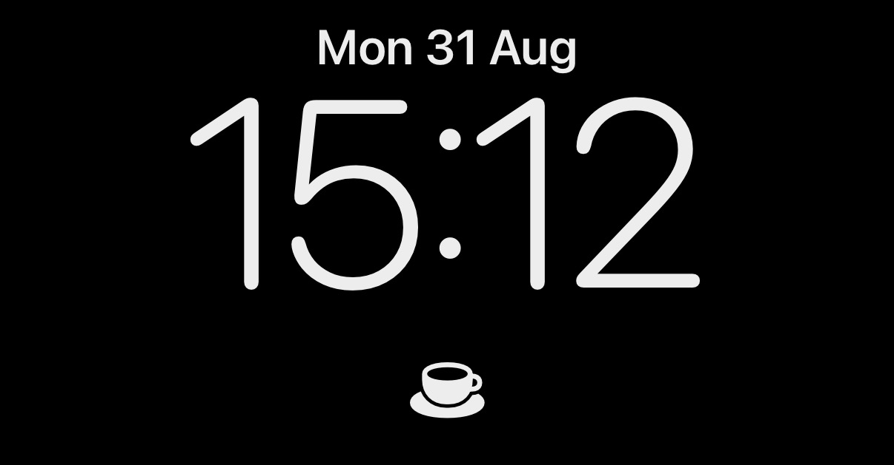
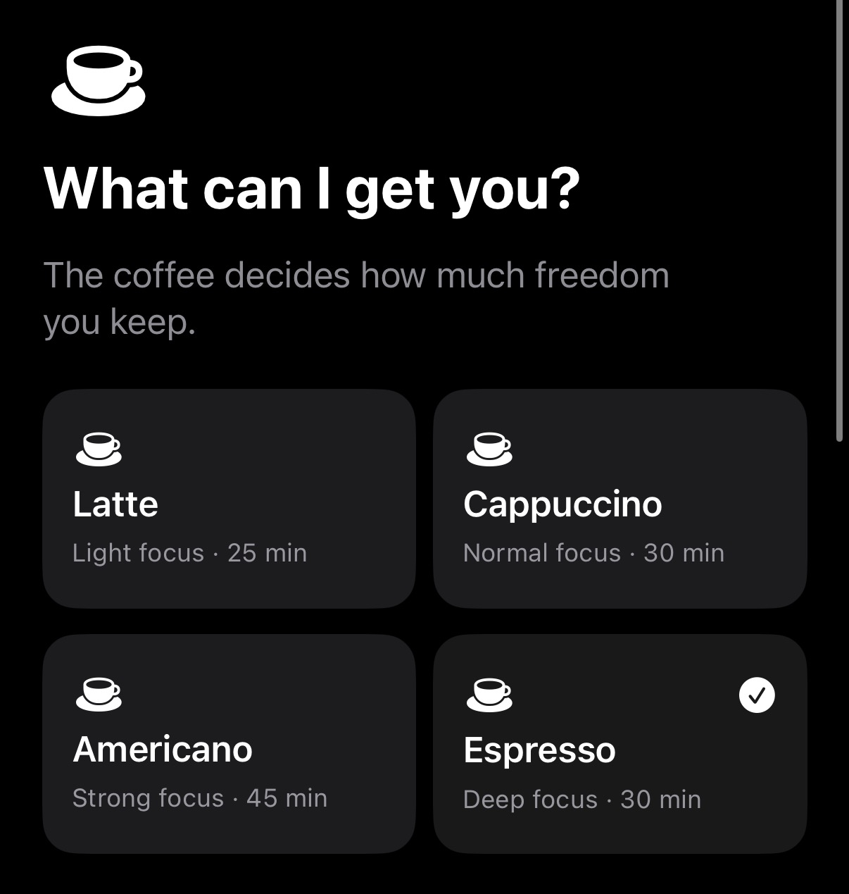
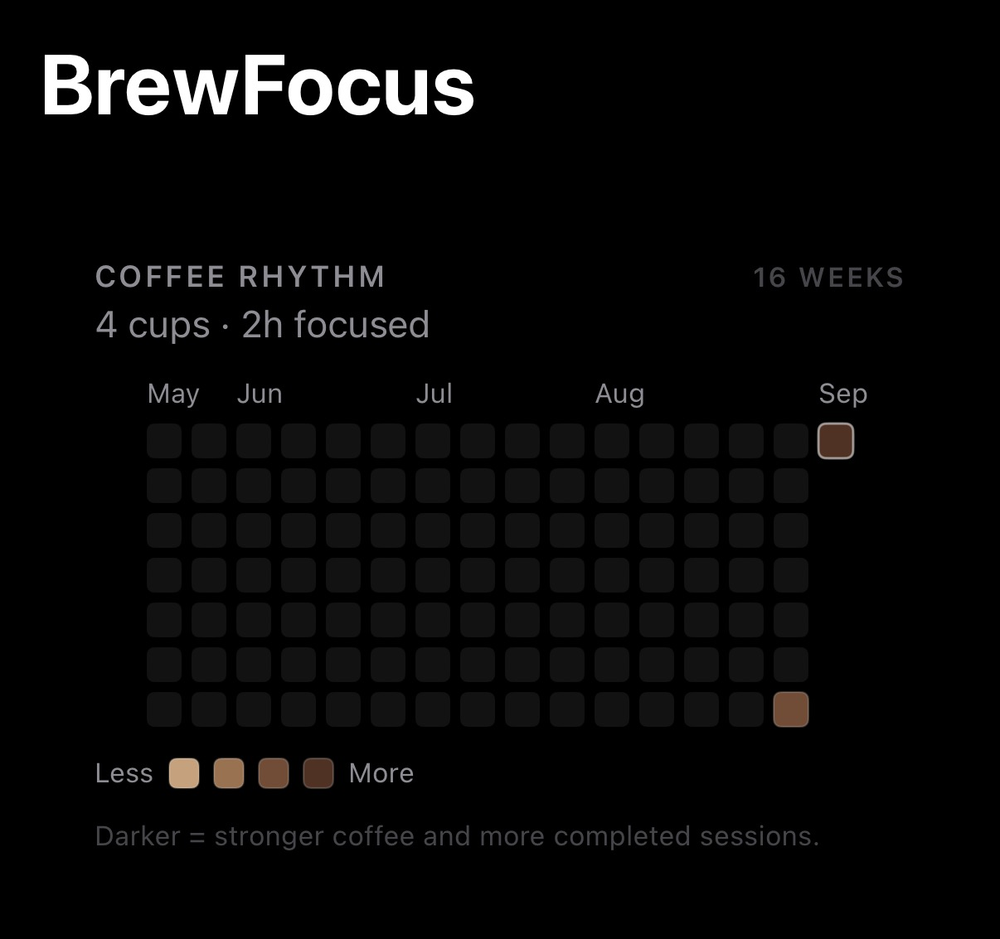

# BrewFocus

**Order a coffee. Get something done.**

BrewFocus is a native, local-first focus tool for macOS and iPhone. Instead of configuring productivity profiles, you choose a coffee. Each coffee represents how much app access you give up for the session.

<p align="center">
  
</p>
<p align="center"><sub>Keep the current coffee within sight, without opening the app.</sub></p>

<table>
  <tr>
    <td width="50%">
      
    </td>
    <td width="50%">
      
    </td>
  </tr>
  <tr>
    <td align="center"><sub>Choose how much freedom the session allows.</sub></td>
    <td align="center"><sub>Build a quiet record of completed focus sessions.</sub></td>
  </tr>
</table>

> BrewFocus is pre-release software. The session lifecycle is covered by automated tests, but the complete physical-device and manual restriction matrices are still in progress.

## Coffee contracts

| Coffee | Focus | Duration | App access |
| --- | --- | ---: | --- |
| Latte | Light | 25 min | All apps remain available |
| Cappuccino | Normal | 30 min | Block 1–4 selected distractions |
| Americano | Strong | 45 min | Keep up to 8 selected essentials available |
| Espresso | Deep | 30 min | Keep up to 4 selected essentials available |

The coffee changes the restriction level, not only the timer.

## What works

### macOS

- Native SwiftUI menu-bar app
- Four fixed coffee recipes
- Real icons for running applications
- Reversible block-list and allow-list restrictions
- Pause, resume, abort, completion, and restart recovery
- Local Cup Shelf and coffee activity heatmap

The Mac restriction engine hides apps cooperatively through documented AppKit behavior. It never terminates another app and is not a security boundary. Some apps or system processes can refuse to hide.

### iPhone

- Native standalone app with the same four coffees
- Screen Time authorization and privacy-preserving app selection
- Device Activity extension for scheduled shield cleanup
- One-hour Morning Quarantine with optional app exceptions
- Quick Coffee through App Intents and Shortcuts
- Inline, circular, and rectangular Lock Screen widgets
- iOS 18 Lock Screen and Control Center control

Physical Screen Time enforcement and distribution signing require Apple capabilities that are not available to unsigned CI builds. See [the iPhone test guide](docs/iphone-spike.md).

## Privacy

BrewFocus stores session data locally. The current codebase has no account system, cloud backend, analytics, advertising SDK, or required network service.

## Requirements

- macOS 14 or later
- iOS 17 or later
- Xcode 16 or later
- A physical iPhone for Screen Time and Lock Screen validation
- [XcodeGen](https://github.com/yonaskolb/XcodeGen) only when regenerating the checked-in Xcode project

## Run the Mac app

1. Clone the repository.
2. Open `BrewFocus.xcodeproj`.
3. Select the `BrewFocus` scheme and **My Mac**.
4. Build and run. BrewFocus appears in the menu bar without a Dock icon.

## Run the iPhone app

The iPhone targets need your own development team, bundle identifiers, App Group, and Family Controls configuration. Follow [Development signing](docs/development-signing.md) before running on a physical device.

Then select the `BrewFocusiOS` scheme and your iPhone.

## Build and test

```sh
xcodebuild \
  -project BrewFocus.xcodeproj \
  -scheme BrewFocus \
  -destination 'platform=macOS' \
  -derivedDataPath /tmp/BrewFocusMacTests \
  CODE_SIGNING_ALLOWED=NO \
  test

xcodebuild \
  -project BrewFocus.xcodeproj \
  -scheme BrewFocusiOS \
  -destination 'platform=iOS Simulator,name=iPhone 17,OS=latest' \
  -derivedDataPath /tmp/BrewFocusiOSTests \
  CODE_SIGNING_ALLOWED=NO \
  test

xcodebuild \
  -project BrewFocus.xcodeproj \
  -scheme BrewFocusiOS \
  -destination 'generic/platform=iOS' \
  -derivedDataPath /tmp/BrewFocusiOSBuild \
  CODE_SIGNING_ALLOWED=NO \
  build
```

Regenerate the Xcode project after changing `project.yml`:

```sh
xcodegen generate
```

## Repository structure

```text
BrewFocus/                       macOS application
BrewFocusiOS/                    iPhone application
BrewFocusShared/                 shared coffee domain and heatmap
BrewFocusiOSShared/              Screen Time and App Group state
BrewFocusDeviceActivityMonitor/  Device Activity extension
BrewFocusWidgets/                Lock Screen and Control Center widgets
BrewFocusWidgetShared/           shared App Intents
BrewFocusTests/                  macOS unit tests
BrewFocusiOSTests/               iPhone unit tests
docs/                            product and technical documentation
```

## Documentation

- [Product vision](docs/vision.md)
- [Coffee contracts](docs/coffee-contracts.md)
- [Architecture](docs/architecture.md)
- [Technical feasibility](docs/feasibility.md)
- [macOS manual test matrix](docs/manual-test-matrix.md)
- [iPhone and physical-device guide](docs/iphone-spike.md)
- [Roadmap](docs/roadmap.md)
- [Contributing](CONTRIBUTING.md)

## Contributing

Issues and pull requests are welcome. Read [CONTRIBUTING.md](CONTRIBUTING.md) and the [Code of Conduct](CODE_OF_CONDUCT.md) first.

## License

BrewFocus is available under the [MIT License](LICENSE).
