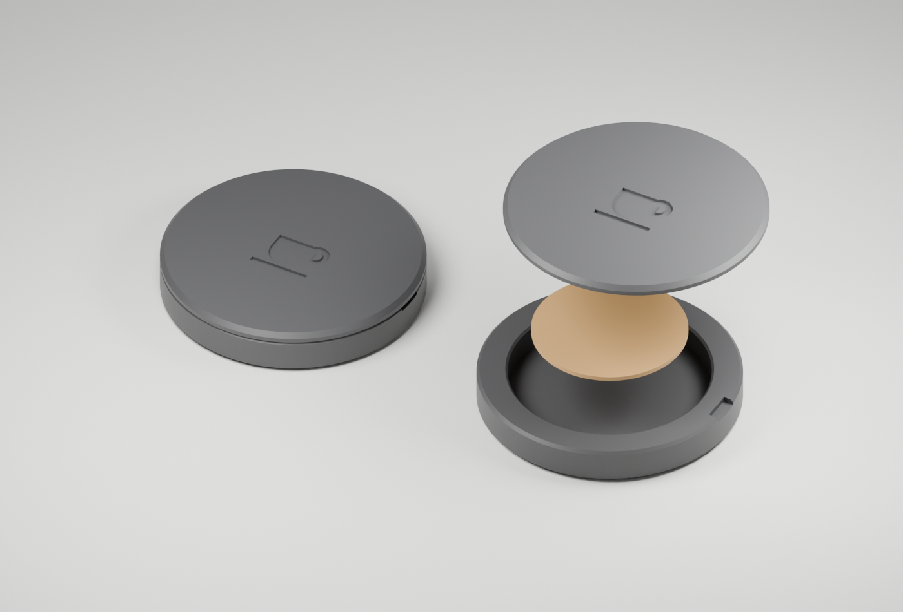

# BrewFocus Focus Tag — 20 mm

A small, monochrome NFC puck for a 20 mm NTAG213 sticker. Designed for a Bambu Lab A1 with a 0.4 mm nozzle. The iPhone app pairs a tag, blocks selected apps on a scan, and unblocks them when the same tag is scanned again.

**Prototype:** geometry is checked, but print fit and NFC read range still need a physical test. The 20 mm diameter is confirmed; sticker/chip thickness is not yet measured.



## Print files

- [Both parts on one plate](exports/brewfocus-tag-print-plate.stl)
- [Base](exports/brewfocus-tag-base.stl)
- [Lid](exports/brewfocus-tag-lid.stl)
- [Editable Blender file](exports/brewfocus-tag.blend)
- [Parametric generator](generate_case.py)
- [Geometry checks](exports/validation.json)

All STL coordinates are millimetres. The assembled puck is **34 mm diameter × 6 mm high**. The tag recess is 21 mm across. The lid leaves 1.2 mm of plastic above the sticker, or 0.8 mm at the recessed coffee mark.

## Bambu Studio / A1

1. Choose **Bambu Lab A1**, **0.4 mm nozzle**, and your matching PLA filament profile.
2. Import the print-plate STL at **100% scale**. If asked, import as one model with multiple parts, or split into objects. Keep both flat faces on the plate, with the cavities pointing up.
3. Start with **0.20 mm Standard**, **3 walls**, **5 top/bottom layers**, **15% infill**, and **no supports**. These are starting settings, not a verified printer profile.
4. The engraved outside of the lid faces the build plate. A clean smooth plate gives the mark a cleaner finish; a textured plate gives it a textured finish.
5. Slice and inspect the first layers and the 0.4 mm-deep mark. Use the filament manufacturer's temperatures through the matching filament profile.
6. Print, let the plate cool, and dry-fit the empty parts before mounting the sticker. The three small retention pads may need light sanding. Do not force the lid.

Ordinary PLA or PETG is suitable for this trial; use a plain filament without metal or carbon fill. Do not add a magnet or mount the bare tag directly against metal. The model has no keyring hole or metal hardware.

## Assemble and test

1. Test the loose tag with the iPhone first, away from the rest of the sticker sheet.
2. Peel off only the release liner. Keep the entire 20 mm antenna intact.
3. Stick the tag to the **inside of the lid**, centred within its ring, adhesive side toward the plastic and chip facing the hollow interior.
4. Scan through the lid before closing the case. No firmware, NDEF writing, or permanent tag locking is needed.
5. Fit the lid into the base. Use the small rim notch to lift it off again. If the lid is loose, regenerate it with less clearance; if tight, increase clearance or gently sand only the retention pads.
6. Repeat at least ten scans through the closed case with your normal phone cover. Confirm both lock and unlock and check an unselected app remains accessible.

Do not glue the prototype shut until fit, tag thickness, and scans are verified. This is a removable friction fit, not a waterproof or certified child-safe enclosure.

## Adjust the model

Blender 5.x was used to generate the supplied files. Run from this directory:

```sh
blender --background --factory-startup --python generate_case.py -- --output exports
```

For a slightly looser lid, use `--clearance 0.20`. The default is **0.15 mm radial clearance**, with three **0.20 mm retention pads**. The pads therefore have a nominal 0.05 mm interference before print variation. Change in 0.05 mm steps; do not scale the whole STL because that also changes the tag pocket and wall thickness.

`--tag-diameter 20` controls the pocket and `--no-render` skips the preview. The generator checks closed edges and positive volume, then produces files in their print orientation. The preview shows those same meshes assembled and exploded; the gold disk illustrates the sticker and is not a print part.

## Bruk på norsk

Skriv ut begge delene i vanlig PLA, 0,20 mm lag og uten støttemateriale. Prøv lokket uten tag først. Lim taggens egen klebeside midt på innsiden av lokket. I BrewFocus åpner du **Focus Tag**, gir Skjermtid-tilgang, velger **Pair a tag**, og velger appene under **Apps to block**. Trykk **Scan to focus** og hold toppen av iPhonen inntil koppsymbolet. Senere bruker du **Scan to unlock** med samme brikke. **Emergency unlock** er tilgjengelig dersom brikken blir borte.

See [the iPhone setup and physical test guide](../../docs/focus-tag.md) before testing restrictions.

For daily tapping without opening the scanner, enable **Allow Shortcut Control** in Focus Tag, then create a personal NFC automation in Apple's Shortcuts app using **Toggle Focus Tag** and **Run Immediately**. Wake the screen before tapping; leave at least three seconds between taps. This optional action can also be run without the physical tag. Every recipient needs the app, Screen Time permission and their own automation; the printed puck cannot block apps by itself. See the linked guide for setup and distribution requirements.
